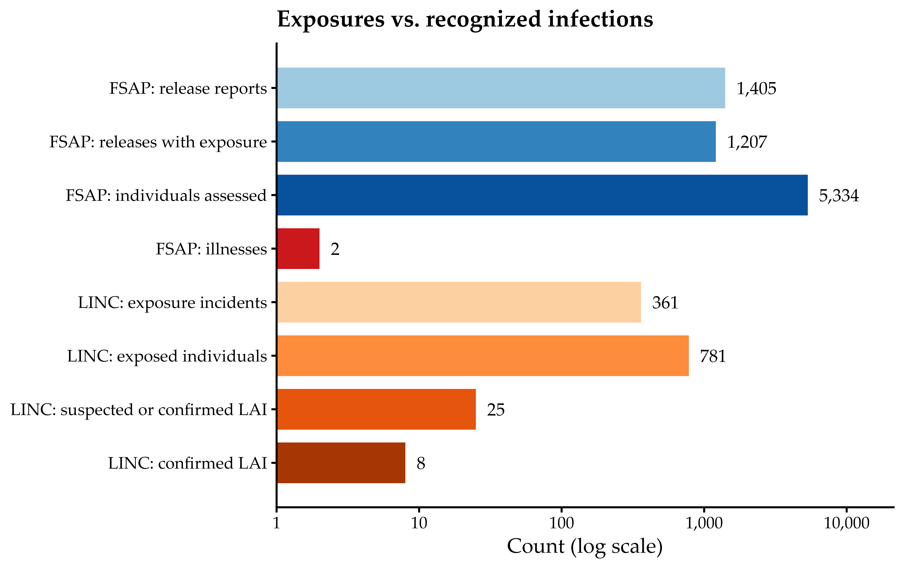
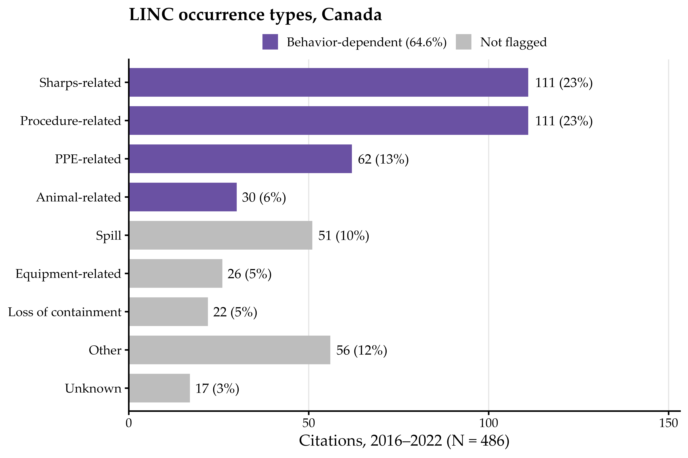

# Laboratory exposures vs. recognized infections

Reproducible R code and data for Figure 2 of:

> Okosun BO, Mughe HC, Essilfie EG, Yolandia JNE, Musongong JA, Oga E.
> *Laboratory Injuries and Occupational Health Risks: Causes and Prevention Strategies.*
> Laboratories, 2027.

Two national mandatory-reporting systems, the U.S. Federal Select Agent Program (FSAP) and Laboratory Incident Notification Canada (LINC), record thousands of laboratory exposures and only a handful of recognized infections. This repository rebuilds that figure from the published counts with one command.

| FSAP by year | Exposures vs. infections | LINC occurrence types |
|---|---|---|
|  |  |  |

## Quick start

```r
install.packages(c("readr", "dplyr", "tidyr", "ggplot2", "ragg"))
source("scripts/figure2.R")     # from the repository root
```

The script writes three PNGs to `results/` and prints the totals behind them. A correct run prints:

| Check | Expected |
|---|---|
| FSAP 2018–2024: release reports / with exposure / individuals assessed / illnesses | 1405 / 1207 / 5334 / 2 |
| LINC 2016–2022: incidents / exposed/suspected or confirmed LAI / confirmed LAI | 361 / 781 / 25 / 8 |
| Panel C | N = 486, 64.6% behavior-dependent |

## Repository layout

```
data/      published counts as tidy CSV (one file per table)
scripts/   figure2.R      draws the three panels
           update_data.R  optional: parse a newly published report into data/
results/   figure2a.png, figure2b.png, figure2c.png
```

## Settings

All settings sit at the top of `scripts/figure2.R`.

| Setting | Default | Effect |
|---|---|---|
| `REPRODUCE_SUBMITTED` | `TRUE` | `TRUE` pins the figure to the published ranges (FSAP 2018–2024, LINC 2016–2022). `FALSE` plots every year in `data/`. |
| `DATA_URL` | this repository | Where the script fetches the latest CSVs. Set to `""` to work offline from `data/`. |
| `DPI` | `1500` | Output resolution. |
| `FONT` | Palatino and clones | The journal specifies Palatino. The script uses the first installed of Palatino, Palatino Linotype, Palatino LT Std, URW Palladio L, P052, TeX Gyre Pagella, and warns if none is found. |

The script downloads the CSVs from `DATA_URL`, keeps a copy in `cache/`, and falls back to the bundled `data/` when offline. A copy of the script alone therefore still picks up years added here later.

## Data

| File | Years | Contents |
|---|---|---|
| `fsap_annual.csv` | 2018–2025 | Release reports, registered and non-registered split, occupational-exposure split, individuals given occupational health services, illnesses, source URL |
| `linc_annual.csv` | 2016–2024 | Active licenses, confirmed exposure incidents, suspected and confirmed LAI incidents, exposed individuals (2023 onward) |
| `linc_occurrence.csv` | 2016–2024 | Occurrence-type citations, long format |
| `linc_period_totals.csv` | 2016–2022 | Pooled totals with LAIs counted per person |
| `coding.csv` | 10 types | Behavior-dependent flag and control-failure mapping (Table S2 Part B of the article) |

Two things to know before reusing the numbers:

1. **The systems count different things.** FSAP counts people given post-exposure care. LINC counts people exposed. The denominators are not comparable and the article does not pool them.
2. **LINC reports LAIs per incident and per person.** For 2016–2022 the person-level counts are 17 suspected and 8 confirmed; the incident-level counts are 15 and 10. Panel B uses the person-level counts. LINC stopped publishing them after 2022, so with `REPRODUCE_SUBMITTED <- FALSE` the LAI bars switch to incidents and the axis label says so.

## Adding a new year

```r
source("scripts/update_data.R")   # from the repository root
row <- fetch_fsap(2026)           # finds and parses the FSAP annual report PDF
append_fsap(row)                  # writes only if the internal balances hold
linc_tables("<URL of the new CCDR article>")
```

`fetch_fsap()` prints every parsed number and `append_fsap()` refuses to write unless the four balances hold (for example, registered + non-registered = release reports). It targets the 2020-onward report wording. LINC changes its article URL and table layout each year, so `linc_tables()` prints the tables and the new row is added by hand. Check every parsed row against the report before committing it.

## Sources

**FSAP.** Annual Reports of the Federal Select Agent Program, 2018–2025, section "Theft, Loss, and Release of BSAT". <https://www.selectagents.gov/resources/publications/index.htm>. Per-year URLs are in `fsap_annual.csv`.

**LINC.** Public Health Agency of Canada, *Canada Communicable Disease Report*:

- Balbontin N, Gauthier A, Abalos C, Davis AN, Lister M. Canadian laboratory incidents with human pathogens and toxins: an overview of reports, 2016–2022. *CCDR* 2024;50(5):144–52. [doi:10.14745/ccdr.v50i05a04](https://doi.org/10.14745/ccdr.v50i05a04)
- Nafees A, et al. Surveillance of laboratory exposures to human pathogens and toxins, Canada, 2023. *CCDR* 2025;51(1):16–25. [doi:10.14745/ccdr.v51i01a03](https://doi.org/10.14745/ccdr.v51i01a03)
- Tran EF, Gauthier A, Davis AN, Abalos C, Bonti-Ankomah S. Surveillance of laboratory exposures to human pathogens and toxins, Canada, 2024. *CCDR* 2025;51(10/11/12):401–12. [doi:10.14745/ccdr.v51i101112a04](https://doi.org/10.14745/ccdr.v51i101112a04)

## Citation and license

Cite the article above; GitHub's "Cite this repository" button reads `CITATION.cff`. Code is MIT licensed. The counts are U.S. government public-domain works and Crown copyright (Canada), reproduced with attribution.

Tested with R ≥ 4.1. Contact: Blessing O. Okosun, [ORCID 0009-0003-6247-3727](https://orcid.org/0009-0003-6247-3727).
